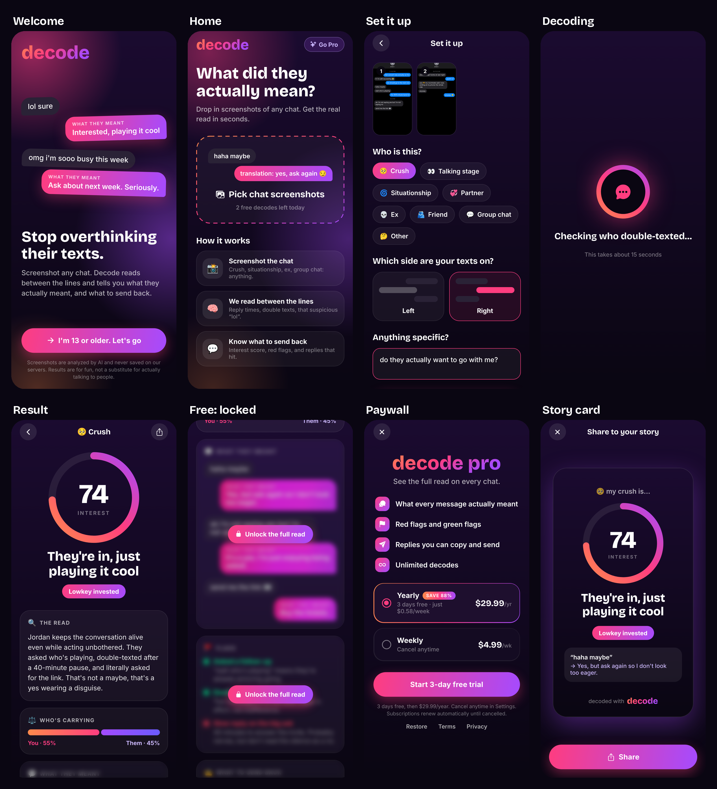

# Decode

**What did they *actually* mean?** Drop in screenshots of a conversation with a crush, situationship, ex, friend or group chat. Decode gives an interest score, a verdict, who's carrying the conversation, red and green flags, what their messages really meant, and replies you can send back.

For ages 13+. Built for the TikTok loop: every result makes a 9:16 card for stories.



## What's here

```
mobile/   The app: React Native + Expo (iPhone, Android, web). No Mac needed.
server/   Cloudflare Worker that sends screenshots to Claude and returns structured JSON
docs/     Screenshots
```

**How a decode works:**
1. The app shrinks the screenshots and sends them to the server.
2. The server asks Claude (`claude-opus-5-5`) for a structured read of the conversation and validates the result.
3. Free users see the score, verdict, vibe and effort split. Pro unlocks the translations, flags, replies and next move, which are blurred until then.

**Pricing:** free users get 2 decodes a day. Pro is $4.99 a week, or $29.99 a year with a 3-day trial.

**Privacy:** the server never stores or logs screenshots. The app keeps past results only on the phone.

**Safety:** the prompt flags signs of grooming, pressure for nudes, sextortion, abuse or self-harm. Those show up as a "Real talk" card that isn't behind the paywall, and Decode never suggests manipulative replies.

## Design: "Afterglow"

A deep plum night (`#0A0612`) with a sunset gradient running through it: orange `#FF8A4C` → pink `#FF3D7F` → violet `#A54BFF`.
- **Signals:** mint `#3DF5B0` for green flags, coral `#FF5A6A` for red.
- **Fonts:** Bricolage Grotesque for headlines and Inter for body text.
- **Chat-bubble translations:** each of their messages appears in a grey bubble, and "what they meant" answers in a gradient bubble, like an iMessage reply.

All tokens live in `mobile/src/theme.ts`.

## Try it on your iPhone (no Mac, no developer account)

1. Install **Expo Go** from the App Store.
2. On any computer with Node 20+:
   ```bash
   cd mobile
   npm install
   npx expo start
   ```
3. Scan the QR code with your iPhone camera. The app opens in Expo Go.

To get real AI results instead of errors, run the server (below). Then copy `mobile/.env.example` to `mobile/.env.local` and fill in your server URL and token.

**Pro on Expo Go:** Expo Go can't make App Store purchases, so for now the paywall unlocks Pro locally (test mode, `src/lib/purchases.ts`).

## Server

```bash
cd server
npm install
cp .dev.vars.example .dev.vars   # add your Claude API key from https://platform.claude.com
npm run dev                      # http://localhost:8787
npm test
```

Deploy it so your phone can reach it:

```bash
npx wrangler login
npx wrangler secret put ANTHROPIC_API_KEY
npx wrangler secret put APP_TOKEN        # make up a long random string
npm run deploy
```

A decode costs a few cents in API usage.

## Ship to the App Store (still no Mac)

Expo's cloud service (EAS) builds and submits the iOS app for you. You'll need an Apple Developer account ($99/year; if you're under 18, a parent or guardian has to enroll).

**Before you build:**
- **Purchases:** replace test mode in `src/lib/purchases.ts` with [RevenueCat](https://www.revenuecat.com/docs/getting-started/installation/expo) (`react-native-purchases`). Create the weekly and yearly subscriptions in App Store Connect.
- **App details:** set your own `ios.bundleIdentifier` in `mobile/app.json`, and real Terms and Privacy URLs in `src/lib/config.ts`.
- **Server security:** replace the shared `APP_TOKEN` with App Attest and add server-side rate limits. The free-tier limit is currently enforced only in the app.

**Build and submit:**

```bash
cd mobile
npx eas-cli@latest build --platform ios
npx eas-cli@latest submit --platform ios
```
